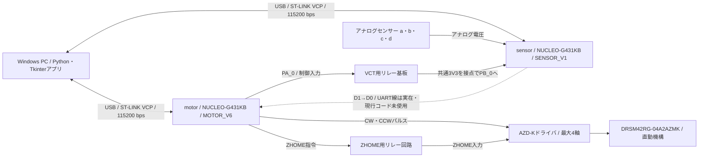

# SuperMEXE02 システム・ハードウェア仕様書

| 項目 | 内容 |
|---|---|
| 文書版 | 1.6 |
| 作成日／更新日 | 2026-11-11／2026-11-14 |
| 実装の確認基準 | ソフトウェア確認基準は `d768f59`（本更新でコード変更なし）。回路・配色の基準は `f86a550` |
| motorファームウェア | `SUPERMEXE02_MOTOR_V6` |
| sensorファームウェア | `SUPERMEXE02_SENSOR_V1` |
| 対象 | Windowsアプリ、2台のNUCLEO、4軸の駆動信号、4系列のアナログ計測 |

本書は、現在のソースコード、利用者から確認した構成、メーカー資料を照合した仕様である。「実装済み」「利用者確認」「未確認」を区別する。将来の研究目標と、現在利用できる機能は第13章に分けて記載する。文字だけで図面を再構成する場合は、[回路・配線の再現仕様](../hardware/HARDWARE_REPRODUCTION.md)を読む。全40部品・278ピン・34ネットと配色を網羅し、[JSON](../hardware/wiring_manifest.json)で同じ内容を機械的に照合できる。特定CADに依存しない部品・端子・接続グループを基準とし、接続CSV・部品CSVも併設している。実機全体の完全複製に不足する情報も同文書へ集約した。

## 1. 目的と全体構成

拍動循環シミュレータに用いる直動機構の動作生成と、アナログセンサー値に基づく可変抵抗のフィードバック制御を行う。PCから最大4軸を扱い、通常動作と最大3系統のPID制御を、異なる軸へ割り当てて並行実行する。



両ボードのGNDは共通。目標値と現在値はPCを経由してmotorへ渡す。sensor D1→motor D0のUART線は実配線として存在するが、現在のコードでは使用しない。線経由へ制御を戻すかどうかは保留。

## 2. 機器と役割

| 機器 | 型番・環境 | 役割・確認状況 |
|---|---|---|
| PC | Windows、VS Code | アプリ実行、設定・保存、波形表示、ビルドと書き込み |
| motorボード | ST NUCLEO-G431KB | 4軸のパルス生成、ZHOME、VCT、最大3系統のPID |
| sensorボード | ST NUCLEO-G431KB | 4入力のADC取得とVCT後の時刻指定取得 |
| 直動アクチュエータ | オリエンタルモーター DRS2 / `DRSM42RG-04A2AZMK` | 利用者が提示した機種。軸ごとの個体番号・銘板写真は未収録 |
| ドライバ | オリエンタルモーター `AZD-K` | パルス列入力形。`AZD-KD`ではない |
| ZHOME回路 | リレーを介してドライバへ接続 | リレー本体は写真よりBESTEP `JQC3F-03VDC-C`。販売型番QCCAN QC19004、3/3.3 V High入力。ZHOME用4枚とVCT用1枚を図面化。内部ジャンパーは未確認 |
| アナログセンサー | 圧力・流量など、最大4系列 | 具体的な型番・電源・校正成績は未確認 |
| 提示された24 V電源 | MEAN WELL `MDR-100-24`、24 V・4 A（96 W） | 2台使用。PS1はA/B軸、PS2はC/D軸。各AZD-K電源とZHOME接点へ分配。ブレーキ配線は未確認 |

NUCLEOの正式な端子・電源仕様は[STの製品ページ](https://www.st.com/en/evaluation-tools/nucleo-g431kb.html)および[UM2397](https://www.st.com/resource/en/user_manual/dm00493601-stm32g4-nucleo32-board-mb1430-stmicroelectronics.pdf)を参照する。

### 2.1 アクチュエータのメーカー仕様

以下は `DRSM42RG-04A2AZMK / AZD-K` のメーカー仕様値であり、実験装置で実測した値ではない。

| 項目 | メーカー仕様 |
|---|---:|
| ストローク | 40 mm |
| ボールねじリード | 2 mm/rev |
| 最高速度 | 50 mm/s |
| 最大推力 | 200 N |
| 押し当て力 | 400 N |
| 最大保持力 | 200 N |
| 電磁ブレーキ | 付き |
| ドライバ電源仕様 | DC 24/48 V |

出典：[メーカー公式の機種・ドライバ組合せ仕様](https://catalog.orientalmotor.com/item/all-categories-legacy-products/42mm-guide-drs-absolute-linear-actuators/drsm42rg-04a2azmk-azd-k)。推力は運転条件に依存する。押し当て力400 Nは、現在のパルス位置制御で常時発生する力を意味しない。押力・トルクを測定する入力は現在ない。

### 2.2 ソフトウェアのパルス換算

現在の換算は、利用者が実験的に確認した **2500パルス/mm** を使用する。経緯として「4 mm/rev・10000パルス/rev」に基づく旧コードの換算を採用している。

- 1パルスの指令移動量：`1 / 2500 = 0.0004 mm`
- 指令位置：`符号付き累積パルス数 / 2500`
- CWを正、CCWを負として扱う。

メーカー記載の機械リード2 mm/revと、旧コードの換算根拠4 mm/revには差がある。ドライバの電子ギヤ／パルス設定を含む対応関係は未記録であり、機械リードを根拠にコードの換算を自動変更しない。指令分解能0.0004 mmは、実位置精度を保証する値ではない。

## 3. 電源・共通配線

| 接続 | 現在把握している内容 |
|---|---|
| PCとmotor | motor側ST-LINK USB端子に接続し、USBから給電（利用者確認） |
| PCとsensor | sensor側ST-LINK USB端子に接続し、USBから給電（利用者確認） |
| ボード間GND | 共通化済みとの利用者申告 |
| ボード間VCC | 両基板の3V3を共通化済み（利用者確認）。USBを含む内部の給電経路と電源設定の適否は未検証 |
| 同期信号 | motor `PA_0`がVCTリレーを制御し、その接点で共通3V3をsensor `PB_0`へ接続（利用者確認） |
| 基板間UART線 | sensor D1/PA9/CN4-1 → motor D0/PA10/CN4-2。実配線あり、現行コードでは未使用 |
| 共通リセット | 両基板のCN4-3/NRST → 1つの外部押しボタン → 共通GNDとする等価回路 |
| ZHOME | GPIO → リレー回路 → AZD-K |
| CW・CCWの電気的接続 | GPIOはCW＋/CCW＋へ直結、CW−/CCW−はマイコンGND。外付け変換回路なし（利用者確認）。説明書の5〜24 V指定との差を図面へ注記 |

実機で、sensor側が無給電のときにmotorの接続不良が発生し、sensor側にも給電すると復帰したとの報告がある。現運用では両ボードの給電を確認してからアプリに接続する。影響の電気的原因は未特定。

NRST、電源、GNDを含め、利用者が説明済みの外部配線は[元図](../hardware/README.md)と[連続配線図](../hardware/continuous_wiring/README.md)へ記録済み。全接続先は[文字による再現仕様](../hardware/HARDWARE_REPRODUCTION.md)を参照。USBと3V3共有に関する内部の給電設定・適合性、未説明のブレーキやAC/PE等は未確認であり、完成した製造用仕様ではない。

### 3.1 sensor入力回路の図面化（2026-11-13）

[KiCadプロジェクト・回路図](../hardware/README.md)を追加。sensor1=a/PA_0、sensor2=b/PA_1、sensor3=c/PA_4、sensor4=d/PA_5の4入力で、Pressure／Flowなどの用途名は固定しない。各入力は510 Ω直列、0.1 µFと47 kΩを対GND、1N4148をGND・3V3へ上下クランプとする。既存3入力は提供図の転記で、PA_5の4入力目は同じ構成を追加した。センサーIN側は意図的な省略。

PB_0はVCT立ち上がりを受けるデジタル入力（内部PullDown）で、指定時間後の計測に用いる。旧コードでは310 ms後のPA_5左室圧を取得していた。現在は遅延を系列ごとに設定できる。実配線はVCT用リレーの接点で共通3V3をPB0へ入れる構成と確認され、回路図へ反映した。

電源MDR-100-24とリレーJQC3F-03VDC-Cは写真で型番を確認した。リレー本体はDC 3 Vコイル表記で、モジュールの制御入力仕様とは区別する。両機器の制御・接点と24 V分配も同じA0横1ページへ統合済み。AC/PE・ブレーキの実配線は未記載。回路図のNUCLEOはUSB端子を上にした全30ヘッダー端子付きの表面図へ更新済み。左CN4・右CN3の番号順は[全端子対応表](../hardware/NUCLEO_G431KB_PINOUT.md)を参照。MCU内部・USB内部は省略し、フットプリント・PCBは未設計。

### 3.2 両マイコン間の実配線（2026-11-13追記）

同じKiCadプロジェクト・A0図面にmotor用U2を配置し、sensor用U1と3V3/GNDを共有。VCTリレーK1、sensor D1→motor D0、NRST共通スイッチSW1を利用者説明に従って記録した。[基板間配線の詳細](../hardware/INTERCONNECTS.md)を参照。リレーはQCCAN QC19004として全6端子を反映済み。制御側は共通3V3とマイコンGND、接点側はVCTでは3V3、ZHOMEでは24 V。両USB給電と3V3共有は既存配線の記録であり、内部の電源経路は未検証。接点の遅れ・チャタリングは現行コードで補正しない。

コードは変更していない。UART線の存在と、PC経由で制御値を渡す現行実装を区別する。図中のmotor側×印には外部配線未記載の端子も含む。

### 3.3 AZD-Kと24 V電源の確定配線

同じKiCadプロジェクト・A0横1ページにAZD-K 4台も統合。CN4全24端子とCN1全5端子を表示し、CN2/CN3は資料に内部割当がないため名称のみ記載。PS1（MDR-100-24）はA/B、PS2はC/Dへ給電し、両電源の−同士とマイコンGNDは接続しない。各ドライバのCN1＋/−へ給電し、ZHOMEリレーCOMへ24 V＋、NOからCN4-3/IN4へ、CN4-5/IN-COMから対応する24 V−へ戻す。22番GNDへ24 V−を接続していたという以前の説明は、利用者により5番への接続と訂正された。

CW＋/CCW＋は3.3 V GPIO直結、CW−/CCW−はマイコンGND。説明書の指定は5〜24 Vであり、今回の図は実配線を記録したもので適合性を実証したものではない。[詳細・端子表・IN-COMの説明](../hardware/AZD_K_WIRING.md)を参照。コードは変更していない。

## 4. motor側ピン割当

以下はすべて **motorボード上の端子**。同名ピンがsensor側にあっても別の信号である。Arduino名はMbedターゲットの`PinNames.h`に基づく補助表記。

| 軸 | CW GPIO | Arduino名 | CCW GPIO | Arduino名 | ZHOME GPIO | Arduino名 |
|---|---|---|---|---|---|---|
| A | `PA_1` | A1 | `PA_4` | A3 | `PB_4` | D12 |
| B | `PB_0` | D3 | `PA_8` | D9 | `PB_5` | D11 |
| C | `PB_6` | D6 | `PB_7` | D4 | `PA_7` | A6 |
| D | `PA_11` | D10 | `PA_12` | D2 | `PA_15` | D5 |

| 共通信号 | GPIO | 内容 |
|---|---|---|
| VCT出力 | `PA_0` / A0 | 全軸共通の周期信号。K1.INを駆動し、K1接点経由で共通3V3をsensor PB_0へ入力（直結ではない） |
| PC通信TX/RX | `USBTX/USBRX` | ターゲット既定値PA_2/PA_3。ST-LINK VCPへ接続 |

CWとCCWは別々のGPIOへパルスを出力する。GPIOの初期出力はLow。図面ではCN4-1=CW＋、CN4-2=CCW＋、CN4-13=CW−、CN4-14=CCW−を記録済み。ドライバ側の入力論理・パルス方式・電子ギヤなど、実機パラメータの記録は引き続き必要。

C/DのZHOMEはコード上独立している。旧配線のC/D共通リレー入力は、C=`PA_7`、D=`PA_15`へ分離する設計としている。回路図では利用者が確認した各軸1枚の独立リレーK2〜K5へ接続済み。現物の個別動作試験記録は未収録。

READY、HOME-END、ドライバALARM、外部リミットの入力は実装していない。ドライバ内蔵絶対位置センサーの実位置をPCへ読み出す通信も実装していない。

## 5. sensor側ピン割当・計測

| 系列・信号 | GPIO | 旧冠循環構成での用途 | 旧設定の倍率 |
|---|---|---|---:|
| a | `PA_0` | 大動脈圧AoP | 50 mmHg/V |
| b | `PA_1` | 左流量 | 200 mL/min/V |
| c | `PA_4` | 右流量 | 50 mL/min/V |
| d | `PA_5` | 左室圧LVP、VCT後取得でLVEDP | 50 mmHg/V |
| VCT入力 | `PB_0` | motor PA_0が制御するK1接点経由の立上がりを検出 | 入力PullDown |
| PC通信 | `USBTX/USBRX` | ST-LINK VCP | 115200 bps |

PA_5を端子A4から使用する際は、ボードのソルダーブリッジとPB_7との共有をUM2397で確認する。Mbedの`A4`名はPB_7へ割り当てられているため、コードは`AnalogIn(PA_5)`を明示している。A5/PA_15とPA_6についても、Arduino名だけで実配線を判断しない。

### 5.1 取得・変換

- 通常取得：100 Hz、目標間隔10000 µs、4入力を順番に読む。同時サンプルではない。
- ADC API：`read_u16()`。送信値0〜65535はAPIで正規化された値であり、ADC実分解能が16 bitという意味ではない。
- PC上の電圧換算：`ADC値 × 3.3 / 65535`。
- 工学値換算：`電圧 × 系列ごとの倍率`。オフセット補正は未実装。
- 3.3 Vはソフトウェアの基準値。入力保護回路の図面定数は第3.1節に記録済み。実際のVDDA、センサー出力範囲、保護性能の実測、校正誤差は未記録。

### 5.2 系列ごとの処理

| 方法 | 処理 | 設定範囲 |
|---|---|---|
| `mean` | 移動窓内の平均 | 窓10〜60000 ms |
| `max` | 移動窓内の最大値 | 同上 |
| `min` | 移動窓内の最小値 | 同上 |
| `trigger` | VCT立上がりから指定遅延後にADC取得し、直近N拍で平均 | 遅延0〜60000 ms、N=1〜100 |

1系列につき取得方法は1つ。例えばaのMINとaの平均を同時に別々の制御へ渡す派生系列機能はない。移動窓と拍平均はPCで処理する。必要な窓・拍数が揃うまでは有効値を出さない。

VCT後取得の予約はsensor MCUで行う。通常サンプルの10 ms刻みには丸めないが、処理ループは約1 ms刻みであり、1 µsの取得精度を保証しない。予約時刻と実際の取得時刻を通信フレームに含める。

予約領域は128件、VCT受信リングは32要素（実効31件）。アプリは予約見積り120件以下とシリアル通信量を検査する。4系列ともtriggerの場合は、現在の保守的な通信量検査ではVCT周期111 ms以上が目安となる。

## 6. 処理分担と通信経路

| 処理 | PC | motor MCU | sensor MCU |
|---|---|---|---|
| ADC取得・時刻付与 | — | — | 実行 |
| VCT後の取得予約 | 遅延設定 | VCT生成 | 立上がり検出・取得 |
| 電圧・単位換算、平均/MIN/MAX | 実行 | — | 生値送信 |
| αの数式・CSV補間 | 実行 | — | — |
| PIDのP/I/D計算 | パラメータ設定 | 実行 | — |
| パルス生成・移動順序 | 動作設定 | 実行 | — |
| グラフ・表・保存 | 実行 | 状態送信 | 生値送信 |

PC―各MCUはST-LINK Virtual COM Portを使用し、115200 bps、8 bit、パリティなし、1 stop bit、フロー制御なし。ASCIIの行単位、送信行末LF。motorの受信はCRも行末として扱う。

VCTは両MCU間の物理同期信号である。sensorとmotorのソフトウェアタイマーは独立で、PCへ送る時刻を共通の絶対時計に同期する機能はない。CSV補間・PC通信を含む制御全体はハードリアルタイムではない。

## 7. 通常運転・VCT・手動操作

| 項目 | 現実装 |
|---|---|
| 軸数 | A〜Dの最大4軸 |
| 軸ごとの動作件数 | 最大32件 |
| 動作種類 | 相対移動、待機、ZHOME |
| 移動指定 | 移動量＋速度、または移動量＋時間 |
| 1回の通常移動量 | 1〜15000パルス＝0.0004〜6 mm |
| 速度指定範囲 | 約0.0002〜20 mm/s。半周期整数µsに丸める |
| 全軸の処理予算 | 最高速度合計の目安20 mm/s、厳密には各軸最高エッジ周波数の合計100000回/s以下 |
| 待機 | 1 µs〜600秒 |
| VCT周期 | 10〜60000 ms、初期値600 ms |
| VCT High幅 | 1 ms以上かつ周期未満、初期値30 ms |
| 軸の開始遅延 | 0〜600秒、軸ごとに設定 |
| 繰り返し | 各軸の符号付きパルス合計が0、動作時間が周期内であることを検査 |
| 繰り返し内ZHOME | 使用不可。開始前ZHOMEは別設定 |
| 手動操作 | CW/CCWを押している間パルス出力。距離による停止条件はなし |
| 手動継続確認 | PCが約100 msごとにJKEEP。motorが500 ms超受信できないと停止 |

時間入力は0.001 ms単位、MCUへの設定は整数µs。時間指定の移動ではパルスのエッジ間隔を配分して総時間を合わせる。入力分解能と実際のタイミング精度は異なる。

VCTは絶対時刻に基づいて次周期を予約する。1 ms超の遅れなどを検出するとTIMING停止するが、±1 ms以内の実測精度が試験で保証済みという意味ではない。

## 8. ZHOMEと指令位置

ZHOME GPIOをHighにする時間は20 ms。その後1秒の固定待機を含め、コード上の1回の所要時間は1.02秒。HOME-END/READYが未接続のため、実際の原点到達を確認しているわけではない。

フィードバック開始時はZHOMEを必ず行う。固定待機後を指令位置0とし、初期位置へ移動する。原点復帰前・未確定状態の表示は`--`。

位置は出力パルスの立上がりで積算し、CWで+1、CCWで−1。フィードバック画面ではmmとパルス数を約1秒ごとに表示し、停止時には最終値を更新する。出力軸変更、設定読込み、接続し直し等では表示を未確定へ戻す。この位置表示はフィードバック系統に対するもので、通常運転4軸の汎用実位置表示ではない。

STOPはパルスとVCTを停止する。ただし、すでにZHOMEを受けたドライバの自律的な原点復帰動作自体をSTOPで中断する機能はない。リレー信号は独立タイマーでLowへ戻し、原点復帰の固定待機中は次の運転を開始しない。

## 9. フィードバック仕様

### 9.1 信号の定義・競合防止

各制御に現在値系列、αの式、α→βの表、出力軸を設定する。βが目標値となる。

```text
センサー電圧 → 倍率・窓処理 → a,b,c,d
    → αの式 → CSV線形補間 → β（目標値）
現在値として選んだ系列 ─────────┐
β ───────────────────────┴→ motorのPID → 位置補正 → CW/CCW
```

- 最大3系統。有効な各系統で出力軸と現在値系列を重複させない。
- 通常運転が登録された軸はPIDへ割り当てられない。
- αはa〜d、数値、四則演算、括弧を使用。式は最大256文字・AST最大100ノード。
- 各制御のαには、その制御の現在値系列を含められない。
- CSVはUTF-8（BOM可）、ヘッダー`alpha,beta`、昇順・重複なし・2〜10000点。範囲外は端のβを使う。

### 9.2 開始シーケンス

1. 通常運転とフィードバック設定を転送し、ACKを確認する。
2. フィードバック軸をZHOMEし、固定待機する。通常運転軸の開始前ZHOMEはチェック設定に従う。
3. フィードバック全軸を設定した初期位置へ移動する。
4. 初期移動の全軸完了後、通常運転とVCTを開始し、`FBREADY ALL`を返す。
5. PCがsensorの取得設定を再送し、計測窓・拍平均を取り直す。
6. 必要な目標・現在値が揃った系統からI/D状態を初期化する。その系統の設定PID周期が経過して最初の補正を行う。

### 9.3 PIDとパラメータ

誤差は`e = 目標値 − 現在値`。微分は現在値の変化率へ一次LPFをかける。出力は次の位置補正パルス数として扱う。

```text
u = 制御方向 × (Kp × e + Ki × 積分値 − Kd × 平滑化した現在値の微分)
次の指令位置 = 現在の指令位置 + 制限・丸め処理後の補正パルス数
```

| パラメータ | 初期値 | 設定範囲・動作 |
|---|---:|---|
| PID周期 | 7500 ms | 100〜600000 ms。実際の経過時間をdtに使用 |
| 初期位置 | 0 mm | −6〜+6 mm、CW位置上限以下 |
| CW位置上限 | +5.2 mm | 設定範囲−6〜+6 mm |
| CCW位置下限 | 制限なし | V6で撤廃。旧JSONのmin_mmも無効化 |
| 1回の最大補正量 | 0.6 mm | 0.0004〜6 mm |
| 移動速度 | 0.8 mm/s | 初期移動と補正移動に使用、通常運転との合計予算を検査 |
| 制御方向 | −1 | −1または+1。CWで現在値が減る系は−1を想定 |
| Kp / Ki / Kd | 13 / 0.05 / 1 | 各0〜1000000。出力単位はパルス |
| デッドバンド最小値 | 1.8 | 0〜10⁹、現在値の単位 |
| デッドバンド比率 | 0.03 | 0〜1 |
| 微分LPF時定数 | 5秒 | 0〜600秒 |

デッドバンドは`max(最小値, abs(目標値) × 比率)`。誤差がこの範囲内なら補正移動をせず、Iを減衰させる。積分上限、出力飽和・位置上限での積分抑制を行う。補正移動中は同じ軸への更新を待ち、完了後に次の更新を行うため、実際の更新間隔が設定周期より長くなることがある。

指令位置は符号付き32 bit。CCWの機構位置下限は設けていないが、数値範囲を超える場合は`FB_POSITION_RANGE`で停止する。機械ストロークとソフトウェア上の指令可能範囲は同一ではない。

### 9.4 旧冠循環設定の対応例

これは移行元の値であり、新規起動時の全設定へ自動適用される初期値ではない。

| 項目 | 左冠：C軸 | 右冠：D軸 |
|---|---|---|
| α | a−d＝minAoP−LVEDP | 同左 |
| 現在値 | b＝左流量の1200 ms平均 | c＝右流量の1200 ms平均 |
| aの取得 | 1800 msのMIN | 共通 |
| dの取得 | VCT後310 ms、2拍平均 | 共通 |
| 初期位置 | +4 mm | +4 mm |
| Kp / Ki / Kd | 13 / 0.05 / 1 | 16 / 0.05 / 1 |
| 周期・最大補正・速度 | 7500 ms・0.6 mm・0.8 mm/s | 同左 |

`AlphaToBeta_conversion/旧コード_冠灌流圧_目標流量.csv`は1511点、24.0〜175.0 mmHgを0.1 mmHg刻みに対応付けている。移行元の.cppコメントは14〜165と記載されていたが、実行時の.hの定義24〜175を採用した。旧コードの四捨五入参照に対し、現在は線形補間する。

旧PIDと新PIDでは、制御方向−1のときのD項の符号、dt、飽和時の積分処理等が異なる。ゲイン値の移行は、旧制御の完全再現を意味しない。旧motorの「100回移動ごとのC/D原点復帰」「毎周期A/B原点復帰」は現在実装していない。

## 10. 通信プロトコル概要

実装の厳密なパラメータ検査は各ソースを正とする。下記はアプリとの接続・保守用の代表フレーム。

### 10.1 motor

| 方向 | フレーム | 意味 |
|---|---|---|
| PC→motor | `HELLO` / `PING` / `STOP` | 版確認／通信継続／全停止 |
| motor→PC | `READY SUPERMEXE02_MOTOR_V6` / `PONG` | 版／継続応答 |
| PC→motor | `CLEAR` / `ADD axis pulses half_us` / `ADDT axis pulses total_us` | 動作転送 |
| PC→motor | `WAIT axis us` / `ZHADD axis` / `RUN` | 待機／ZHOME登録／通常運転開始 |
| PC→motor | `HOME axis` / `JOG axis signed_half_us` / `JKEEP` | 即時ZHOME／手動／手動継続 |
| PC→motor | `CONFIG period width delayA delayB delayC delayD prehome repeat vct` | 時間はµs、後ろ3項目は0/1 |
| PC→motor | `VCT period_us width_us` | VCT単独運転 |
| PC→motor | `FBCFG id axis period_us initial_p reserved high_p step_p half_us polarity kp ki kd dead ratio tau` | PID設定。id=0〜2、V6のreservedは0 |
| PC→motor | `FBRUN` / `FBVAL id target current` | フィードバック開始／目標・現在値更新 |
| motor→PC | `FBREADY ALL` | 初期移動完了、計測取り直し開始 |
| motor→PC | `FBSTAT id state position_p` | 系統状態・指令位置 |
| motor→PC | `STOPPED reason` / `ERR reason` | 停止理由／指令エラー |

FBSTATのstate：0=停止、1=原点復帰中、2=初期位置移動、3=計測待ち、4=PID中、5=原点未確定。
motorは最大255文字の行と最大24トークンを扱う。PCは接続時にSTOP応答を確認してから操作を有効にする。

### 10.2 sensor

| 方向 | フレーム | 意味 |
|---|---|---|
| PC→sensor | `HELLO` | 版確認 |
| sensor→PC | `READY SUPERMEXE02_SENSOR_V1` | 版応答 |
| PC→sensor | `SENSORCFG mask delay_a delay_b delay_c delay_d` | bit0〜3がtrigger系列、遅延はµs |
| sensor→PC | `ACK SENSORCFG` | 設定反映。保留中の取得予約をクリア |
| sensor→PC | `S sequence timestamp_us raw_a raw_b raw_c raw_d` | 100 Hzの通常取得 |
| sensor→PC | `T beat channel scheduled_us sampled_us raw` | VCT後取得、channel=0〜3 |
| sensor→PC | `FAULT TRIGGER_QUEUE` / `FAULT SAMPLE_OVERRUN` | 予約過多／通常取得の処理遅延 |

PCは初回の正しいREADYより前に受けた非ASCII行を捨てて同期を取り直す。版確認後の文字化けは異常として扱う。初回・再設定時の応答待ちは5秒。

## 11. アプリ・保存・表示

| 項目 | 仕様 |
|---|---|
| 実装 | Python、Tkinter/ttk、pyserial |
| タブ | 動作の登録・実行／周期・ZHOME・手動操作／センサー設定／フィードバック／モニター |
| sensor読取り | 専用スレッド。PCの窓処理・目標値更新・描画は約200 ms周期 |
| グラフ | 各制御の目標値と処理済み現在値、5 Hz、直近120秒・各最大600点 |
| 表 | 4系列の電圧・処理値、各制御のα・β・現在値・誤差・指令位置・状態 |
| 設定保存 | Windows標準ダイアログ、JSON、`SuperMEXE02.motion-settings`、version=1 |
| 保存先初期値 | リポジトリ直下`motion_settings/`。保存ダイアログで変更可能 |
| 保存内容 | 通常動作、VCT・遅延、手動設定、センサー設定、PID設定、CSVの数値 |
| 保存しないもの | COM接続状態、実行状態、現在位置、グラフ履歴、未登録の入力欄の動作 |
| 読込み | 設定のみ復元し、自動接続・自動運転しない。上限4 MiB |
| 計測記録 | 表示履歴のCSV等への連続記録機能は未実装 |

COM番号・USBドライブ文字は固定値ではない。過去にmotor=COM6、sensor=COM12、書込み先E:を確認したが、接続ごとに実際の割当を確認する。

`脳循環0.7L_min一定.csv`は全行のβが0.7の表で、低圧域の低下や単位換算を実装するものではない。現在値の単位がL/minなら0.7 L/min、mL/minなら0.7 mL/minとなるため、系列の倍率・単位と揃える。ファイル名から自動変換はしない。

## 12. 停止・待機条件

異常停止では、通常運転を含む全軸のパルスとVCTを停止する。自動再開はしない。

| 条件 | 判定・動作 |
|---|---|
| 手動STOP、アプリ終了・切断 | STOPを送信。通信不能時はmotorの監視により停止 |
| PC継続信号の途絶 | 約200 msごとのPINGをmotorが2秒超受信できないと`LINK_TIMEOUT` |
| 目標・現在値更新の途絶 | 系統が最初の値を受信した後、1.5秒超で`FB_DATA_TIMEOUT` |
| sensorデータの途絶 | 約1秒で異常。設定応答待ち等を除き、アプリがSTOP |
| sensorフレーム異常 | 欠落、時刻逆行、通常サンプルの時刻差50 ms超、版不一致、再起動、接続後の文字化け等 |
| 計算異常 | ゼロ除算・範囲外等はアプリでSTOP。PID出力が非有限値なら`FB_NUMERIC` |
| motorタイミング異常 | 移動エッジが100 µs超遅延、待機等が1 ms超遅延、次エッジまで5 µs未満、VCTが1 ms超遅延、周期重複等で`TIMING` |
| 指令応答異常 | ACK不一致、応答待ち約2秒超、motorの応答途絶3秒超等で停止・切断 |
| 数値位置範囲超過 | `FB_POSITION_RANGE` |

目標値への到達、デッドバンド内、CW上限への到達、補正移動中、初回の窓・拍平均待ちは、運転終了ではない。補正を休止または制限して監視を続ける。最初の有効値を受け取る前には、PIDデータの1.5秒タイムアウトは開始しない。

力、実位置、機械端、ドライバALARM、センサーの物理的な故障やADC飽和を直接検出する停止機能はない。例えばADC値65535も形式上有効な値として扱う。通信監視はハードウェア非常停止回路を構成するものではない。

## 13. 研究への適用範囲と未実装事項

現実装は4系列・4軸・最大3PIDの汎用制御基盤。冠循環の旧設定の移行例と、脳流量を一定値へ制御するためのCSVを含む。

### 13.1 利用者が提示した循環モデル・目標条件

利用者の研究説明では、シリコーン製左心室・大動脈弁、大動脈基部・弓部、左右冠動脈・脳・上肢・末梢の分岐回路、弾性静脈リザーバーで閉鎖系を構成する。アクチュエータでチューブを圧迫し、拍動に同期する冠血管圧迫と、流量を調整する可変抵抗を模擬する。各分岐の実配管、静脈側の接続点、ECMO送脱血位置は図面未照合。

以下は利用者から提示された研究上の目標・仮定であり、現システムでの達成を証明する試験結果ではない。

| 条件 | 正常条件の目標 | ショック条件の目標 |
|---|---|---|
| 心拍数 | 70 bpm | 100 bpm |
| 大動脈圧 | 120/80 mmHg | 85/45 mmHg |
| 心拍出量 | 5.0 L/min | 2.4 L/min |
| SVR | 1400 dyn·s·cm⁻⁵ | 1600 dyn·s·cm⁻⁵ |
| 右房圧相当値 | 5 mmHgと仮定 | 10 mmHgと仮定 |
| LVEDP | 未指定 | 18 mmHg |

目標には、左右で異なる二峰性冠流量波形、冠灌流圧―流量曲線への追従、脳循環のMAP 60〜120 mmHgで約0.7 L/minの維持と低圧域での流量低下、病態・MAPによる目標SVR更新、VA-ECMO増流時の配分評価が含まれる。

### 13.2 追加実装が必要な機能

以下は研究構想・追加検討事項であり、現在の機能として完成したものではない。

- 脳血流の低灌流域を含むMAP―目標流量曲線、病態別の自動調節能の切替。
- MAP・平均静脈圧・総灌流量から計算したSVRを「現在値」として扱う制御。
- 病態・MAPに応じた目標SVRの更新。
- 同じ圧力入力から平均とMINを同時に取り出す派生系列。
- 左右冠＋脳＋SVRを同時に行う4系統PID。
- 現在のA/B拍動機構とC/D抵抗機構を維持したまま脳・末梢の各駆動を追加する場合の計6軸化。
- 追加の脳流量・総流量・静脈圧入力、ECMO流量を含む収支の測定。
- 押力計測、実位置読出し、リミット入力、実験データの連続保存。

循環回路の実物について、左室・大動脈弁・各分岐・リザーバーの寸法、チューブ、コンプライアンス、流体、センサー型番、ECMO送脱血位置を再現できる図面・台帳は未収録。研究説明で提示された構成と、実機で測定・検証済みの性能を区別する。

## 14. 開発・書き込み・運用

### 14.1 リポジトリと依存関係

| パス | 内容 |
|---|---|
| `G431KB_motor/main.cpp` | 動作・パルス・VCT・通信 |
| `G431KB_motor/feedback_controller.h` | PID・初期化・指令位置状態 |
| `G431KB_sensor/main.cpp` | ADC・VCT予約・sensor通信 |
| 各プロジェクトの`mbed-os.lib` | Mbed OSの参照コミット |
| `motor_app/` | PCアプリ・モデル・テスト |
| `AlphaToBeta_conversion/` | 変換表CSV |
| `.vscode/tasks.json` / `.vscode/mbed.ps1` | 開発タスク・ビルド／書込み |

両Mbedプロジェクトは`ARMmbed/mbed-os`の`17dc3dc2e6e2817a8bd3df62f38583319f0e4fed`を参照する。Mbed OS本体とBUILDはGitへ含めない。新規取得後は各プロジェクトでMbed CLI 1の`mbed deploy`等により依存を復元する。

### 14.2 現在の開発環境

Mbed Studio同梱Python、Mbed CLI 1、Arm Compiler 6とそのライセンスを利用する。VS Codeは編集・タスク実行用。ターゲット`NUCLEO_G431KB`、ツールチェーン`ARMC6`、プロファイル`debug`。

スクリプトは`%LOCALAPPDATA%/Mbed Studio/mbed-studio-tools/`と、`%LOCALAPPDATA%/Programs/Mbed Studio/tools-config/ac6-license.dat`を参照する。別PCではMbed Studioの導入場所・ライセンス・pyserial/Tkinterの利用可否を確認する。

| VS Codeタスク | 内容 |
|---|---|
| `Mbed: G431KB_motor Build / Rebuild / Flash` | motorをビルド／クリーンビルド／書込み |
| `Mbed: G431KB_sensor Build / Rebuild / Flash` | sensorを同様に処理 |
| `Mbed: Build both` | 両方を順番にビルド |
| `App: Motor control` | PCアプリ起動 |

BIN出力先は各プロジェクトの`BUILD/VSCode/NUCLEO_G431KB/ARMC6/debug/`。Flashは指定ドライブのDETAILS.TXTを確認し、BINをコピーし、FAIL.TXTがあればエラーにする。ドライブのボード役割を自動識別していないため、motorとsensorの書込み先を確認する。

### 14.3 起動の順番

1. 実機の配線・給電状態を確認する。ボードの役割とCOM、USBドライブを識別する。
2. 必要な版を対応ボードへ書き込む。書込み中はアプリ・他のシリアルモニターを閉じる。
3. アプリを起動し、motorのCOMを接続する。接続自体では移動・ZHOMEを開始しない。
4. センサー設定を入力またはJSONから復元し、別のsensor COMへ接続する。
5. 電圧と処理済み値・単位を確認する。trigger値にはVCTが必要。
6. 通常動作、またはフィードバック開始ボタンで実行する。

### 14.4 確認済み範囲

2026-11-11、基準コミットのアプリ自動テスト89件と両MCUのビルドが成功。debugビルド時の静的RAM/Flashは、motor=15106/64107 bytes、sensor=15781/54415 bytes。スタック・ヒープの実使用量を測定した値ではない。

利用者から両ボードの書込み・アプリ接続・基本動作成功の報告があり、sensor COMへの連続3回の接続と取得も確認している。一方、全運転条件でのVCT精度、長時間安定性、制御ゲイン、実位置誤差、推力、チューブ閉塞力、研究上の圧―流量特性の追従性能は検証記録が未整備。

## 15. 未確認事項の台帳

| 優先項目 | 追加で記録する内容 |
|---|---|
| 電源・共通VCC | 外部3V3・GND・独立24 V系統の接続は図面化済み。残りは実個体のUSB内部経路・給電設定・端末処理・適合性 |
| ドライバ・リレー | 型番、CN4/CN1、6端子リレー、24 V分配は図面化済み。残りは個体銘板、実パラメータ、内部ジャンパー、CN2/CN3ケーブル・ブレーキ・FG・AC/PE等 |
| パルスと距離 | 電子ギヤ／分解能の設定、距離校正手順、2 mmリードと採用換算の対応 |
| センサー | 型番、レンジ、電源、出力、オフセット、校正、飽和判定 |
| 基板設定 | 実ボードのソルダーブリッジ、PA_5/A4等の配線 |
| 機械系 | 各軸のCW方向、原点、可動端、押し面・受け台、チューブ材質・寸法 |
| 循環回路 | 回路図、分岐と計測点、流体、静脈リザーバー、ECMO接続点 |
| 性能試験 | VCTジッター、入力校正、位置校正、押力、閉塞、連続運転、制御応答 |

## 16. 関連資料

- [文字だけで回路を再構成する仕様（全接続・全端子・不足情報）](../hardware/HARDWARE_REPRODUCTION.md) / [機械可読JSON](../hardware/wiring_manifest.json)
- [KiCad回路図・機器型番の記録](../hardware/README.md)
- [アプリの操作説明](../motor_app/README.md)
- [motorファームウェア](../G431KB_motor/main.cpp) / [PID実装](../G431KB_motor/feedback_controller.h)
- [sensorファームウェア](../G431KB_sensor/main.cpp)
- [PC側の計測・目標値モデル](../motor_app/feedback_model.py)
- [設定ファイルの形式・検証](../motor_app/settings_store.py)
- [変換表フォルダー](../AlphaToBeta_conversion/)
- ST：[NUCLEO-G431KB](https://www.st.com/en/evaluation-tools/nucleo-g431kb.html) / [UM2397](https://www.st.com/resource/en/user_manual/dm00493601-stm32g4-nucleo32-board-mb1430-stmicroelectronics.pdf)
- オリエンタルモーター：[DRSM42RG-04A2AZMK](https://www.orientalmotor.co.jp/ja/products/detail?hinmei=DRSM42RG-04A2AZMK) / [AZD-K組合せ仕様](https://catalog.orientalmotor.com/item/all-categories-legacy-products/42mm-guide-drs-absolute-linear-actuators/drsm42rg-04a2azmk-azd-k)
