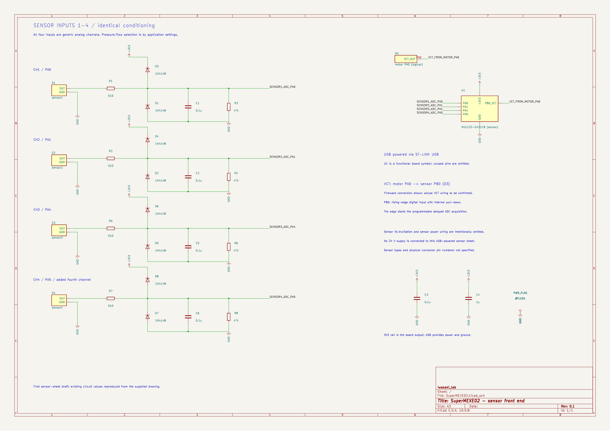

# SuperMEXE02 回路図

KiCad 10で **[SuperMEXE02.kicad_pro](SuperMEXE02.kicad_pro)** を開き、回路図エディターを起動してください。回路図・プロジェクト専用シンボル・ライブラリー設定は同じフォルダーに揃っています。

## 現在の範囲

2026-11-13の利用者説明と提供図をもとにした、sensor側の4入力回路です。motor側・リレー・24 V電源の配線は今後の説明に従って追加します。

| 図中名 | アプリ系列 | MCU入力 | 510 Ω直列 | 47 kΩ対GND | 0.1 µF対GND | 下側／上側1N4148 |
|---|---|---|---|---|---|---|
| sensor1 | a | PA_0 | R1 | R3 | C1 | D1／D3 |
| sensor2 | b | PA_1 | R2 | R4 | C2 | D2／D4 |
| sensor3 | c | PA_4 | R5 | R6 | C5 | D5／D6 |
| sensor4 | d | PA_5 | R7 | R8 | C6 | D7／D8 |

Pressure／Flow／Flow1はsensor1／2／3に変更し、同じ回路をsensor4として追加しました。圧力・流量などの意味と換算はアプリ側で設定します。C3=0.1 µF、C4=1 µFも提供図から引き継いでいます。

センサーのIN側は意図的な省略です。励起・センサー電源の配線は描いていません。両NUCLEOは現在USB給電です。3V3はNUCLEOの出力、GNDはUSB由来の共通基準として表現しています。以前申告されたボード間VCC共通化の対象端子は未確認です。

U1とS1〜S4は機能を示す専用シンボルです。ピン識別子はPA0／OUT等の信号名で、物理ヘッダー番号ではありません。未使用端子・USB内部回路は省略しています。フットプリントとPCBはまだ作っていません。PA_5をボードのA4端子から使用する場合は、ソルダーブリッジとPB_7との共有状態を確認する必要があります（[システム仕様書](../docs/SYSTEM_SPEC.md)参照）。

## PB0の意味

現行[sensorコード](../G431KB_sensor/main.cpp)はPB_0を`InterruptIn`として使い、内部PullDownを設定して立ち上がりを検出します。VCTを受けた時刻を基準に、設定時間後のADC取得を予約します。初期遅延は310000 µs（310 ms）で、アプリから系列ごとに変更できます。100 Hzの通常取得は別に動作します。

想定接続は **motor PA_0（VCT出力）→sensor PB_0（D3）** と共通GNDです。図中M1はこの別ボードの論理出力を示します。利用者が実配線を忘れているため、現物確認済みの配線としては扱いません。motor自身のPB_0はB軸CWで、sensor PB_0とは別の信号です。

旧`ColonaryArtery_FlwPrsReader/main.cpp`では、PB_0の立ち上がりから310 ms後の左室圧（PA_5）を取得し、直近2回を平均して左室拡張末期圧相当値として扱っていました。現在はその時刻指定取得を汎用化しています。

## 写真から確認した機器

| 機器 | 判読した型番・表示 | まだ決めていないこと |
|---|---|---|
| DC電源 | MEAN WELL **MDR-100-24**、出力24 V・4 A（96 W）、入力100–240 VAC | 各ドライバ・ブレーキ等への実際の分配と接続 |
| リレー本体 | BESTEP **JQC3F-03VDC-C**（DC 3 Vコイル表記）、接点10 A・250 VAC／30 VDC等の表示 | モジュール基板自体の型番、制御入力電圧・論理、端子順、実配線 |

電源銘板の「DC OK max.30 VDC/1 A」は状態出力接点の定格です。24 V主出力の定格とは別です。[MEAN WELL公式仕様書](https://www.meanwell.com/Upload/PDF/MDR-100/MDR-100-SPEC.PDF)を参照。

リレーのコイル3 Vという表記だけで、モジュールの入力電圧や3.3 V GPIOとの適合性は確定しません。写真にはPC817C表記の部品も見えますが、絶縁構成・ジャンパー設定は未確認です。今回の図では、このモジュールと24 V電源をセンサー回路へ接続していません。

写真の根拠：2026-11-13に利用者が提供した電源銘板、リレー表面・裏面の3画像。型番の読み取りを記録したもので、基板全体の回路を推定したものではありません。

## ファイルと検証

- `SuperMEXE02.kicad_pro`：開くプロジェクト。
- `SuperMEXE02.kicad_sch`：編集可能な回路図。
- `SuperMEXE02_IO.kicad_sym` / `sym-lib-table`：プロジェクト専用シンボルと相対パス設定。
- `sensor_channels.json`：チャンネルと部品番号の対応。
- `previews/`：SVG・PNGプレビュー。
- [検証記録](checks/README.md)：ERCとネットリスト照合。

元の回路定数を再現した段階であり、センサーの出力範囲・保護性能・実配線の適合確認は今後行います。ファームウェアとPCアプリは今回変更していません。
