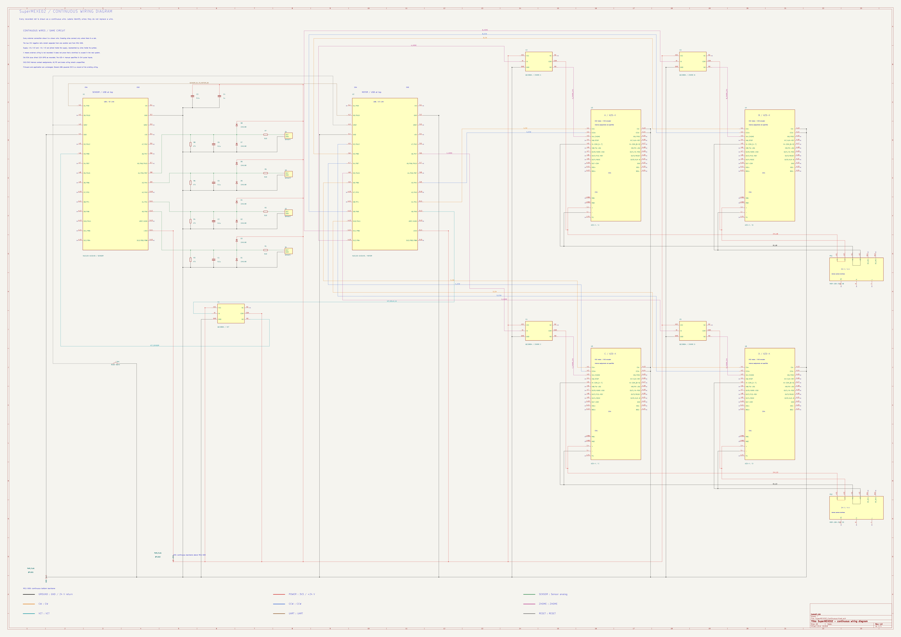

# 線を省略しない連続配線図

**[SuperMEXE02_Continuous.kicad_pro](SuperMEXE02_Continuous.kicad_pro)** をKiCadで開いてください。元の[全体回路図](../SuperMEXE02.kicad_pro)とは別のプロジェクトです。元の配置とラベル接続の形式も残しています。元図・連続図の両方に同じ色設定を適用しています。

[拡大可能なSVG](previews/SuperMEXE02_Continuous.svg)

## 文字だけで回路を再構成する場合

[回路・配線の再現仕様](../HARDWARE_REPRODUCTION.md)に、両図で共通する全部品・全端子・全ネットを記載しています。[機械可読JSON](../wiring_manifest.json)では元図と連続図のネット名を同じ端子集合に対応づけています。

## この図の見方

2026-11-14作成。A0横の1ページに、sensor用U1、motor用U2、4入力回路、AZD-K×4、リレー×5、24 V電源×2を配置しました。既存図と全ての部品ピンの接続先が一致します。マイコン・PCアプリの変更はありません。

- CW/CCW、ZHOME、VCT、UART、共通リセットを、マイコンの端子から接続先まで線で描いています。
- 3V3とマイコンGNDも、各部品から共通の幹線まで線が続きます。同名ラベルや離れた電源記号による接続の省略はありません。
- PS1はA/B、PS2はC/Dへ給電。0V_AB・0V_CD・マイコンGNDは、それぞれ別の線です。
- 線が交差するだけの場所は接続しません。接続点の丸がある場所は接続します。ラベルは線の名前を示すだけです。
- 電源の＋V端子同士・−V端子同士は、もともと内部で共通です。その等価接続を電源シンボルの枠内の線で表し、新たな外部ジャンパーを指示していません。
- 配線の長さやページ内の経路は見やすさのための配置です。実機のケーブル長・引き回し・端子穴の物理的な加工指示ではありません。

未説明のモータ・エンコーダ・ブレーキ・AC/PE等は追加していません。×印には外部配線未記載の端子を含みます。3.3 V直結パルス入力などの留意事項・型番・端子表は[元図と共通の配線仕様](../AZD_K_WIRING.md)を参照してください。

## 配線の色

KiCad標準のネットクラスで、同じ種類の信号を同じ色にしました。図の下端にも色見本があります。

| 種類 | 色 |
| --- | --- |
| マイコンGND・24 V電源の−（0V_AB / 0V_CD） | 黒 |
| 3V3・24 V電源の＋ | 赤 |
| センサー1～4のアナログ信号（510 Ωの前後とも） | 緑 |
| A～DのCW信号 | オレンジ |
| A～DのCCW信号 | 青 |
| ZHOME信号（リレー制御側・接点出力側） | 赤紫 |
| VCT信号（リレー制御側・接点出力側） | 青緑 |
| sensor D1 → motor D0の通信線 | 茶 |
| 共通リセット信号 | 灰 |

色は信号の種類を表します。同じ色でも別の線は別の接続で、電圧も同じとは限りません。0V_AB・0V_CD・マイコンGNDは元どおり分離されています。リレーのVCC/COMなど電源につながる端子は、電源の色を使っています。

`.kicad_sch`単体ではなく、このフォルダーの**`.kicad_pro`から開く**と色設定も読み込まれます。色を変更する場合は「回路図の設定 → ネットクラス」で変更できます。配線が従来の緑色で、周囲だけに色が付く場合は、「設定 → 環境設定 → 回路図エディター → 表示オプション」の **Highlight netclass colors** をオフにすると配線自体が指定色になります。表記はKiCadの表示言語によって異なります。

[KiCad 10公式の説明](https://docs.kicad.org/10.0/en/eeschema/eeschema.html#_net_classes)

## 検証

KiCad 10.0.8でERCのエラー0・警告0。ラベル・電源名の電気的な接続機能を無視し、端子位置・299本の線分・接続点だけで連続性を検査しました。全ネットが線だけで接続し、元の回路図とも一致しています。[確認記録](checks/README.md)を参照。
